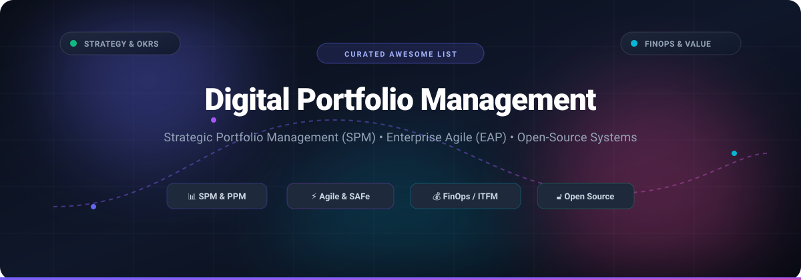

  

# Awesome Digital Portfolio Management (DPM) 🚀

  
  
  
  
  
  
  

> 🧭 A comprehensive, curated list of enterprise Digital Portfolio Management (DPM), Strategic Portfolio Management (SPM), Project Portfolio Management (PPM), FinOps governance platforms, and battle-tested open-source systems.

Digital Portfolio Management (DPM) connects high-level enterprise business strategy, digital products, services, agile delivery, and financial performance. It equips leaders, engineering executives, and PMOs to align investments, model capacity scenarios, track real-time value streams, and eliminate portfolio execution bottlenecks.

---

## 📑 Contents

- [🌐 Sector Overview & Market Dynamics](#-sector-overview--market-dynamics)
- [🏢 Enterprise SaaS & Commercial Platforms](#-enterprise-saas--commercial-platforms)
- [🔓 Open-Source Solutions](#-open-source-solutions)
- [🎯 Key Evaluation Criteria](#-key-evaluation-criteria)
- [🌟 Star History](#-star-history)
- [💖 Support & Community](#-support--community)
- [🤝 Contributing](#-contributing)
- [📄 License](#-license)

---

## 🌐 Sector Overview & Market Dynamics

The global Digital Portfolio Management and Strategic/Project Portfolio Management (SPM/PPM) market is valued at approximately **$8.6B to $9.9B (2024–2025)** and is projected to surpass **$11.2B by 2026**, growing at a steady compound annual growth rate (CAGR) of ~12% to 12.8%.

The sector exhibits a **bifurcated market structure**: it is **moderately concentrated at the top tier**, where enterprise juggernauts (such as Broadcom, IBM, ServiceNow, Atlassian, and Planview) dominate Fortune 500 strategic portfolios through M&A and platform lock-in; while remaining **highly fragmented across mid-market and specialized agile tiers**, where innovative SaaS challengers and open-source alternatives continuously emerge to solve lean portfolio management and developer workflow needs.

---

## 🏢 Enterprise SaaS & Commercial Platforms

The table below lists leading commercial DPM and Strategic Portfolio Management SaaS platforms, sorted in descending order by parent company size (market valuation / enterprise capitalization).

| Product 📦 | Parent / Vendor 🏛️ | Company Size (Valuation / Revenue) 📈 | Starting Tier Pricing 💵 | Free Tier / Trial Limits ⏳ | Key Portfolio Capabilities ⚙️ |
| :--- | :--- | :--- | :--- | :--- | :--- |
| [Broadcom Clarity PPM](https://www.broadcom.com/products/software/enterprise-software/clarity-ppm) | Broadcom Inc. | ~$800B+ Market Cap ($38.8B+ FY23 Revenue) | $60 / user / month (baseline annual contract; enterprise minimums apply) | No permanent free tier; evaluations available via vendor proof-of-concept / guided enterprise demos | Full-lifecycle Strategic Portfolio Management (SPM), investment planning, roadmapping, capacity planning, and financials |
| [IBM Apptio](https://www.apptio.com/) | IBM | ~$200B+ Market Cap ($61.8B+ FY23 Revenue; Apptio acquired for $4.6B) | $2,500 / month ($30,000 / year base for up to $1M managed spend; ITFM modules start at $6,670/mo) | 28-day free trial (Apptio Cloudability) with limited scope & optimization validation; no permanent free tier | Technology Business Management (TBM), FinOps, IT Financial Management (ITFM), and multi-cloud portfolio spend tracking |
| [IBM Targetprocess](https://www.apptio.com/products/targetprocess/) | IBM (via Apptio) | ~$200B+ Market Cap ($61.8B+ FY23 Revenue; Apptio unit) | $30 / user / month (billed annually, typically packaged from $40,500/year for team cohorts) | 30-day evaluation trial provisioned via sales/partner request (invitation links expire in 7 days); no self-service free tier | Enterprise Agile Planning (EAP), SAFe portfolio management, value stream mapping, and OKR alignment |
| [ServiceNow DPM](https://www.servicenow.com/products/digital-portfolio-management.html) | ServiceNow | ~$180B+ Market Cap ($8.9B+ FY23 Revenue) | $70 / fulfiller / month (baseline ITSM Foundation required; DPM store app is included with paid platform fulfiller licenses) | Free persistent Personal Developer Instance (PDI) via developer.servicenow.com with full sandbox access (reclaimed if inactive for 10 days); no production free tier | Unified workspace across enterprise services, business apps, products, projects, incidents, and infrastructure health |
| [Atlassian Jira Align](https://www.atlassian.com/software/jira/align) | Atlassian | ~$45B+ Market Cap ($3.9B+ FY23 Revenue) | $129 / full user / month ($77,400 / year base entry tier covering up to 50 full users, requires Jira Cloud Premium/Enterprise) | No free tier and no self-service trial; guided enterprise proof of concepts offered via Atlassian enterprise partners | Scaled Agile Framework (SAFe), portfolio-to-code traceability, multi-tier OKRs, roadmapping, and release train coordination |
| [Planview](https://www.planview.com/) | Planview (TA Associates & TPG) | ~$1.6B+ Valuation (~$450M–$500M ARR) | $19 / user / month (AgilePlace entry tier; enterprise Portfolios/AdaptiveWork start at $60–$100/user/mo or ~$51K/yr base) | 30-day free trial on ProjectPlace and AgilePlace (unlimited Kanban boards & workspace collaboration); enterprise Portfolios trial by demo only | Strategic Portfolio Management, enterprise agile planning, dynamic resource management, and value stream delivery |
| [Meisterplan](https://meisterplan.com/) | Meisterplan Inc. | ~$4.7M Annual Revenue (Private SaaS) | €600 / month (Basic tier covering up to 50 active managed resources, unlimited user logins) | 30-day free trial with full Pro Edition access and pre-configured templates; no credit card required; data removed after 30 days if not subscribed | Lean project portfolio management, interactive what-if scenario planning, capacity allocation, and resource bottleneck resolution |

---

## 🔓 Open-Source Solutions

Self-hosted, transparent, and developer-friendly platforms for project, product, and digital wealth portfolio management. Sorted in descending order by GitHub stargazer count.

| Project 🛠️ | GitHub_Stars ⭐ | Primary Language / Stack 💻 | License 📜 | Description 📝 |
| :--- | :---: | :--- | :--- | :--- |
| [OpenProject](https://github.com/opf/openproject) |  | Ruby on Rails, Angular, PostgreSQL | GNU GPL v3 | Leading open-source web platform for product, project, and strategic portfolio management. Features agile boards, multi-project hierarchies, Gantt roadmaps, cost tracking, and team resource planning. |
| [Leantime](https://github.com/Leantime/leantime) |  | PHP, JavaScript, MySQL | AGPL v3 | Strategic, goals-focused project and portfolio management system designed with cognitive accessibility (ADHD/Autism) in mind. Bridges high-level OKRs, milestone roadmaps, and lean task execution. |
| [Ghostfolio](https://github.com/ghostfolio/ghostfolio) |  | TypeScript, Angular, NestJS, Prisma | AGPL v3 | Privacy-first open-source wealth and digital asset portfolio management software. Delivers real-time portfolio performance tracking, asset allocation breakdown, cashflow analytics, and multi-currency metrics. |
| [Portfolio Performance](https://github.com/portfolio-performance/portfolio) |  | Java, Eclipse RCP | Eclipse Public License 2.0 | Open-source desktop application to calculate the overall performance of an investment and digital assets portfolio using True-Time Weighted Rate of Return (TTWROR) and Internal Rate of Return (IRR). |
| [Rotki](https://github.com/rotki/rotki) |  | Python, TypeScript, Vue.js | AGPL v3 | Privacy-respecting portfolio tracking, accounting, analytics, and management application for digital assets, multiple exchange integrations, and decentralized financial portfolios. |
| [skfolio](https://github.com/skfolio/skfolio) |  | Python (scikit-learn) | BSD 3-Clause | Comprehensive Python library for digital financial portfolio optimization, factor risk modeling, and risk management built seamlessly on top of scikit-learn compatible APIs. |
| [LibrePlan](https://github.com/LibrePlan/libreplan) |  | Java | AGPL v3 | Collaborative enterprise web application for project and portfolio planning, Earned Value Analysis (EVA), dynamic resource allocation groups, and multi-project Gantt schedules. |

---

## 🎯 Key Evaluation Criteria

When selecting between commercial and open-source portfolio systems, evaluate:

1. 🎯 **Strategic Alignment & OKR Mapping:** Ability to correlate everyday deliverables, features, and Epics to high-level strategic objectives and portfolio horizons.
2. 👥 **Resource Capacity & Scenario Modeling:** Support for real-time what-if simulations, team utilization tracking, and skill constraint modeling.
3. 💳 **Financial Governance & FinOps:** Granular budget allocation, planned vs. actual cost comparisons, capital expenditure (CapEx) vs. operational expenditure (OpEx) attribution.
4. 🔌 **Integration Ecosystem:** Direct hooks into CI/CD pipelines, issue trackers (Jira, GitHub, GitLab), ERPs (SAP, Oracle), and ITSM suites.
5. 🛡️ **Data Privacy & Governance:** On-premises vs. SaaS deployment options, role-based access control (RBAC), and regulatory compliance audits.

---

## 🌟 Star History

---

## 💖 Support & Community

Thank you for visiting and supporting **Awesome Digital Portfolio Management**! 🎉

If you found this curated collection helpful in navigating DPM, SPM, or portfolio frameworks:
- ⭐ **Star** this repository on GitHub to show your appreciation and help others discover it.
- 🍴 **Fork** it and build upon the knowledge base for your team or organization.
- 📢 **Share** it with your engineering leaders, PMO peers, and agile transformation groups!

☕ If you'd like to support the ongoing maintenance and curation of open resources:

  

---

## 🤝 Contributing

Contributions are always welcome! 💡
1. Fork this repository.
2. Create a descriptive branch: `git checkout -b feature/add-tool-name`.
3. Add your entry following the established table structure and sorting rules.
4. Open a Pull Request with details about why the tool or resource fits Digital Portfolio Management.

---

## 📄 License

This work is licensed under the [MIT License](LICENSE).
